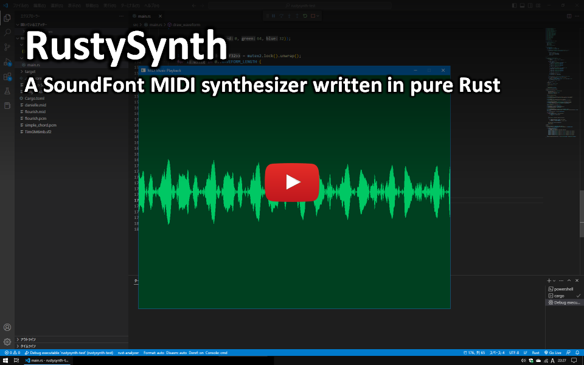

# RustySynth-ext

[](https://github.com/beicause/rustysynth/actions)
[](https://github.com/beicause/rustysynth)
[](https://crates.io/crates/rustysynth-ext)
[](https://docs.rs/rustysynth-ext)

RustySynth-ext is a SoundFont MIDI synthesizer written in pure Rust, ported from [MeltySynth](https://github.com/sinshu/meltysynth). It is a fork of [RustySynth](https://github.com/sinshu/rustysynth) that adds optional SoundFont3 (`.sf3`) support.


## Differences from Upstream

The public API follows upstream, and the optimized renderer produces the same
waveform bit for bit as the previous release; this fork adds:

* **SoundFont3 support** behind the `sf3` feature, decoding the Ogg Vorbis
  samples with the pure-Rust Symphonia decoder in parallel on up to eight
  threads.
* **Faster rendering and loading.** A voice is mixed into both channels in a
  single pass, and the hot loops of the oscillator, the biquad filter and the
  reverb keep their state in locals. Loading a font reserves its buffers once
  and streams the sample data instead of copying it through a temporary buffer.
* **A programmatic MIDI API.** `MidiMessage` is public, and `MidiFile` can be
  built from any iterator of `(time, message)` pairs with `new_with_events` and
  `extend_events`, without an intermediate `Vec`.
* **Hardened parsing.** Malformed SoundFonts and MIDI files are reported as
  errors instead of panicking, aborting or hanging. See the changelog for the
  full list.
* **Golden tests and a benchmark** for the workspace: reference MIDI is rendered
  with a reference font and compared against snapshots, and the benchmark
  reports the CPU time of rendering and loading.


## Features

* Suitable for both real-time and offline synthesis.
* Supports standard MIDI files with additional features including dynamic tempo changing.
* No dependencies other than the standard library.
* Optional SoundFont3 (`.sf3`) support via the `sf3` cargo feature (uses the pure-Rust Symphonia Ogg Vorbis decoder, and decodes the samples in parallel).


## Demo

This is a demo video to show the synthesizer running on [rust-sfml](https://github.com/jeremyletang/rust-sfml) in real-time.

https://www.youtube.com/watch?v=o9rPTJIPmVk

[](https://www.youtube.com/watch?v=o9rPTJIPmVk)


## Installation

RustySynth-ext is available on [crates.io](https://crates.io/crates/rustysynth-ext):

```
cargo add rustysynth-ext
```

To load SoundFont3 (`.sf3`) files, which store Ogg-Vorbis-compressed samples, enable the optional `sf3` feature:

```
cargo add rustysynth-ext --features sf3
```


## Examples

Here are some example codes.

> [!NOTE]
> Each example omits the `use` statements.
> For full code, see the respective links.

[An example code to synthesize a simple chord:](example/src/main.rs#L15)

```rust
// Load the SoundFont.
let mut sf2 = File::open("TimGM6mb.sf2").unwrap();
let sound_font = Arc::new(SoundFont::new(&mut sf2).unwrap());

// Create the synthesizer.
let settings = SynthesizerSettings::new(44100);
let mut synthesizer = Synthesizer::new(&sound_font, &settings).unwrap();

// Play some notes (middle C, E, G).
synthesizer.note_on(0, 60, 100);
synthesizer.note_on(0, 64, 100);
synthesizer.note_on(0, 67, 100);

// The output buffer (3 seconds).
let sample_count = (3 * settings.sample_rate) as usize;
let mut left: Vec<f32> = vec![0_f32; sample_count];
let mut right: Vec<f32> = vec![0_f32; sample_count];

// Render the waveform.
synthesizer.render(&mut left[..], &mut right[..]);
```

[Another example code to synthesize a MIDI file:](example/src/main.rs#L41)

```rust
// Load the SoundFont.
let mut sf2 = File::open("TimGM6mb.sf2").unwrap();
let sound_font = Arc::new(SoundFont::new(&mut sf2).unwrap());

// Load the MIDI file.
let mut mid = File::open("flourish.mid").unwrap();
let midi_file = Arc::new(MidiFile::new(&mut mid).unwrap());

// Create the MIDI file sequencer.
let settings = SynthesizerSettings::new(44100);
let synthesizer = Synthesizer::new(&sound_font, &settings).unwrap();
let mut sequencer = MidiFileSequencer::new(synthesizer);

// Play the MIDI file.
sequencer.play(&midi_file, false);

// The output buffer.
let sample_count = (settings.sample_rate as f64 * midi_file.get_length()) as usize;
let mut left: Vec<f32> = vec![0_f32; sample_count];
let mut right: Vec<f32> = vec![0_f32; sample_count];

// Render the waveform.
sequencer.render(&mut left[..], &mut right[..]);
```

[Yet another example code to synthesize a MIDI file in real-time with the TinyAudio crate:](https://github.com/sinshu/rustysynth/blob/tinyaudio/workspace/src/main.rs)

```rust
// Setup the audio output.
let params = OutputDeviceParameters {
    channels_count: 2,
    sample_rate: 44100,
    channel_sample_count: 4410,
};

// Buffer for the audio output.
let mut left: Vec<f32> = vec![0_f32; params.channel_sample_count];
let mut right: Vec<f32> = vec![0_f32; params.channel_sample_count];

// Load the SoundFont.
let mut sf2 = File::open("TimGM6mb.sf2").unwrap();
let sound_font = Arc::new(SoundFont::new(&mut sf2).unwrap());

// Load the MIDI file.
let mut mid = File::open("flourish.mid").unwrap();
let midi_file = Arc::new(MidiFile::new(&mut mid).unwrap());

// Create the MIDI file sequencer.
let settings = SynthesizerSettings::new(params.sample_rate as i32);
let synthesizer = Synthesizer::new(&sound_font, &settings).unwrap();
let mut sequencer = MidiFileSequencer::new(synthesizer);

// Play the MIDI file.
sequencer.play(&midi_file, false);

// Start the audio output.
let _device = run_output_device(params, {
    move |data| {
        sequencer.render(&mut left[..], &mut right[..]);
        for (i, value) in left.iter().interleave(right.iter()).enumerate() {
            data[i] = *value;
        }
    }
})
.unwrap();

// Wait for 10 seconds.
std::thread::sleep(std::time::Duration::from_secs(10));
```


## Todo

* __Wave synthesis__
    - [x] SoundFont reader
    - [x] Waveform generator
    - [x] Envelope generator
    - [x] Low-pass filter
    - [x] Vibrato LFO
    - [x] Modulation LFO
* __MIDI message processing__
    - [x] Note on/off
    - [x] Bank selection
    - [x] Modulation
    - [x] Volume control
    - [x] Pan
    - [x] Expression
    - [x] Hold pedal
    - [x] Program change
    - [x] Pitch bend
    - [x] Tuning
* __Effects__
    - [x] Reverb
    - [x] Chorus
* __Other things__
    - [x] Standard MIDI file support
    - [x] MIDI file loop extension support
    - [x] Performance optimization


## Development

The workspace keeps its developer tasks in the `xtask` crate:

```
cargo xtask fetch-fonts        # download the test fonts into samples/
cargo xtask generate-goldens   # regenerate the golden data in rustysynth_test/
cargo xtask-bench              # benchmark rendering and SoundFont loading
```

`cargo xtask-bench` builds the benchmark in release mode and prints the process
CPU time of each case next to its wall clock. On a busy machine the wall clock
of a benchmark swings by well over 10%, while the CPU time of the same build is
reproducible to about 1%, so the CPU time is the number to compare against when
judging a change. It needs Linux for that; elsewhere only the wall clock is
shown. `--reps <n>` sets the number of runs per case, `--font <path>` picks a
font other than the default, and `--dump <dir>` writes the rendered waveform so
that two builds can be compared bit for bit with `cmp`.


## License

RustySynth-ext is available under [the MIT license](LICENSE.txt). It is a fork of [RustySynth](https://github.com/sinshu/rustysynth), whose copyright notice is preserved in the license text.
